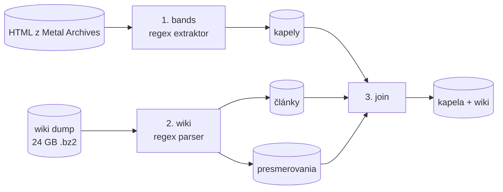

# Konzultácia 3: Spark, wiki dump a join

Repozitár: <https://github.com/K-o-m-A/vinf>

## 1. Prehľad

- Spracovanie dát beží v **Apache Spark** (PySpark): extrakcia kapiel z Metal Archives (MA), parsovanie wiki dumpu aj join.
- Wiki dump (anglická Wikipédia, 24 GB) spracúvame **regulárnymi výrazmi**, bez XML parsera.
- Kapely z MA sme spojili s článkami na Wikipédii: **3 905 unikátnych wiki stránok**.
- Join sme overili voči Wikidatám: 99,4 % pripojených párov je správnych.

| Súbor | Čo robí |
|---|---|
| [`sparkjobs/jobs.py`](https://github.com/K-o-m-A/vinf/blob/main/sparkjobs/jobs.py) | Spark joby: kapely, wiki dump, join |
| [`sparkjobs/wiki.py`](https://github.com/K-o-m-A/vinf/blob/main/sparkjobs/wiki.py) | regexy na parsovanie wiki stránky |
| [`sparkjobs/matching.py`](https://github.com/K-o-m-A/vinf/blob/main/sparkjobs/matching.py) | skóre páru kapela × článok |
| [`sparkjobs/evaluate.py`](https://github.com/K-o-m-A/vinf/blob/main/sparkjobs/evaluate.py) | overenie joinu voči Wikidatám |
| [`docker-compose.yml`](https://github.com/K-o-m-A/vinf/blob/main/docker-compose.yml) | Spark klaster: master + 2 workery |
| [`tests/test_wiki.py`](https://github.com/K-o-m-A/vinf/blob/main/tests/test_wiki.py) | testy regexov a joinu na reálnych článkoch |

## 2. Spracovanie v Sparku



1. **bands**: ~201 tisíc HTML stránok z MA spracuje extraktor z 1. odovzdania, teraz paralelne v Sparku.
2. **wiki**: dump čítame po stránkach (oddeľovač `</page>`). Formát bz2 sa dá deliť na bloky, takže Spark spracúva 24 GB súbor paralelne bez rozbalenia. Ponecháme články o hudobníkoch a skupinách a všetky presmerovania (alternatívne mená, napr. *Burn the Priest* → *Lamb of God*).
3. **join**: kapitola 4.

### Klaster

Rovnaký kód beží aj na Spark klastri v Dockeri (master + 2 workery po 4 jadrách). Join na klastri dáva rovnaký výsledok ako lokálny beh.

| Krok | Čas |
|---|---|
| bands | 93 min (lokálne) |
| wiki | 51 min (lokálne) |
| join | 4,3 min lokálne, 5,6 min na klastri |

Klaster beží na jednom počítači, preto nie je rýchlejší.


## 3. Práca s wiki dátami (REGEX)

Všetky regexy sú v [`sparkjobs/wiki.py`](https://github.com/K-o-m-A/vinf/blob/main/sparkjobs/wiki.py). Najdôležitejšie:

| Regex | Čo nájde |
|---|---|
| `<title>(.*?)</title>`, `<redirect title="([^"]*)"` | titulok stránky, presmerovanie |
| `\{\{\s*Infobox[ _]+(?:musical[ _]+artist\|band\|musician)` | infobox hudobníka alebo skupiny |
| `^\s*\|\s*([A-Za-z_ ]+?)\s*=(.*?)(?=^\s*\|…=\|\Z)` | polia infoboxu (`\| origin = Oslo, Norway`) |
| `\[\[(?:[^\|\]]*\|)?([^\]]*)\]\]` | odkaz → text (`[[Euronymous\|Øystein Aarseth]]` → *Øystein Aarseth*) |
| `\[\[\s*Category\s*:\s*([^\|\]]+?)…\]\]` | kategórie |
| `\{\{\s*Short description\s*\|([^}\|]*)` | krátky popis (*Norwegian black metal band*) |
| `^==\s*(?:band\s+)?members\s*==` | sekcia so zoznamom členov, keď ho infobox nemá |
| `\s+[–—-]\s*\|\s*[(,:;]` | meno člena bez nástroja: *Chuck Schuldiner – guitars (1995)* → *Chuck Schuldiner* |
| `\b(?:band\|musical group\|…)\b` | článok bez infoboxu je o skupine (*Italian metal band*) |
| `established in (\d{4})` | rok vzniku z kategórie |
| `^==` + odstránenie `\{\{…\}\}`, `<ref>`, `[[File:…]]` | úvodný odsek článku ako čistý text |

Šablóny môžu byť vnorené (`{{Infobox … {{hlist|…}} }}`), čo jeden regex nespáruje. Preto ich odstraňujeme opakovane od najvnútornejšej, alebo počítame `{{` a `}}`.

Príklad výstupu pre *Mayhem (band)* (skrátené):

```json
{"title": "Mayhem (band)", "short_description": "Norwegian black metal band",
 "lead": "Mayhem is a Norwegian black metal band formed in Oslo in 1984. They were one of the pioneers …",
 "origin": "Oslo, Norway", "start_year": 1984, "genres": ["Black metal"],
 "labels": ["Deathlike Silence", "Season of Mist", "Century Media", "…"],
 "members": ["Necrobutcher", "Hellhammer", "Attila Csihar", "Teloch", "Ghul"],
 "past_members": ["Euronymous", "Dead", "Count Grishnackh", "…"]}
```

## 4. Join Metal Archives ↔ Wikipédia

### Prečo

MA má presné zostavy a diskografie, ale nemá popularitu, dlhší popis ani vzťahy medzi kapelami. Wikipédia to dopĺňa. Článok na Wikipédii má necelé 2 % kapiel z MA a sú to práve tie známe, preto je samotný článok dobrý signál popularity.

### Ako

MA a Wikipédia nemajú spoločné id, preto spájame cez meno:

1. **Normalizované meno**: bez diakritiky, medzier, interpunkcie a úvodného *The*. *Mötley Crüe* → `motleycrue`.
2. **Kandidáti**: Spark equi-join mena kapely s menami článku (titulok, meno z infoboxu, presmerovania).
3. **Skóre**: rovnakých mien je veľa (na MA je 15 kapiel *Mayhem*), preto každý pár obodujeme:

   | Zhoda | Body |
   |---|---|
   | spoločný člen | 3 za každého (max. 9) |
   | krajina | 2 |
   | rok vzniku (± 1) | 2 |
   | mesto | 1 |
   | článok je o metale | 1 |

4. **Prijatie**: pár berieme pri skóre ≥ 7, alebo pri spoločnom členovi a zhodnej krajine. Výnimky pre články bez členov a pre sólo projekty sú v [`matching.py`](https://github.com/K-o-m-A/vinf/blob/main/sparkjobs/matching.py).
5. **Výber**: každý článok dostane najviac jednu kapelu a naopak (najvyššie skóre).

Príklad pre článok *Mayhem (band)*:

| Kapela na MA | Krajina | Vznik | Spoloční členovia | Skóre |
|---|---|---|---|---|
| Mayhem (id 67) | Norway | 1984 | 14 | **15** → pripojená |
| Mayhem (id 7406) | United States | 1983 | 0 | 3 → zamietnutá |
| Mayhem (id 54480) | Finland | 1983 | 0 | 3 → zamietnutá |

### Výsledok

| | Počet |
|---|---|
| kapiel z MA | 201 389 |
| článkov z Wikipédie | 125 182 |
| kandidátnych párov (rovnaké meno) | 45 493 |
| **pripojených unikátnych wiki stránok** | **3 905** |

### Overenie

Wikidata pri 3 409 našich kapelách uvádzajú, ktorý článok k nim patrí. Join tieto údaje nepoužíva, slúžia len na kontrolu:

- **99,4 %** našich párov sa s Wikidatami zhoduje,
- **91,4 %** párov z Wikidát join našiel.

Join vynechá najmä kapely, pri ktorých sa zhoduje málo údajov (článok bez členov, iný rok vzniku), a kapely zapísané inak (*唐朝* → *Tang Dynasty*). Časť „nesprávnych“ párov je tá istá kapela, ktorá má na MA aj záznam pod starým menom (*Idle Hands* / *Unto Others*).

## 5. Atribúty z Wikipédie, ktoré nás zaujímajú

Pokrytie = koľko z 3 905 pripojených článkov atribút má.

| Atribút | Pokrytie | Prečo |
|---|---|---|
| článok a jeho dĺžka | 100 % | popularita, ktorú MA nemá |
| úvodný odsek (`lead`) | 99,7 % | text na fulltextové vyhľadávanie a popis vo výsledkoch; MA má len krátky komentár |
| kategórie | 100 % | fakty: rok vzniku, vydavateľstvá, ocenenia (*Grammy Award winners*) |
| žánre | 97,5 % | aj nemetalové žánre (*hard rock*, *progressive rock*), ktoré MA nemá |
| krátky popis | 94,9 % | jedna veta do výsledkov vyhľadávania |
| pôvod (`origin`) | 92,8 % | mesto vzniku |
| vydavateľstvá | 87,5 % | celá história; MA má len posledné |
| členovia | 82,6 % | kontrola joinu, mená používané na Wikipédii (*Euronymous*) |
| web | 56,2 % | oficiálna stránka |
| súvisiace kapely | 11,8 % | vzťahy medzi kapelami (*Metallica* → *Megadeth*) |

## 6. Ďalej

Pre 4. odovzdanie: index v PyLucene nad kapelami s údajmi z Wikipédie a porovnanie so starým indexom.

Neskôr: popularita z počtu odkazov a návštevnosti, graf vzťahov medzi kapelami, albumy z Wikipédie, články o členoch kapiel.

## 7. Spustenie

```bash
pip install -r requirements.txt   # pyspark, Java 17
aria2c -x2 -d data/wiki -o enwiki-latest-pages-articles.xml.bz2 \
    https://dumps.wikimedia.org/enwiki/latest/enwiki-latest-pages-articles.xml.bz2

python -m sparkjobs bands     # kapely z MA
python -m sparkjobs wiki      # wiki dump
python -m sparkjobs join      # join → data/spark/bands_wiki, join_stats.json
python -m sparkjobs eval      # overenie voči Wikidatám → eval_stats.json

# na klastri
docker compose up -d
docker compose exec spark-master /opt/spark/bin/spark-submit \
    --master spark://spark-master:7077 --driver-memory 2g --executor-memory 3g run_spark.py join

python -m unittest discover -s tests -v
```
