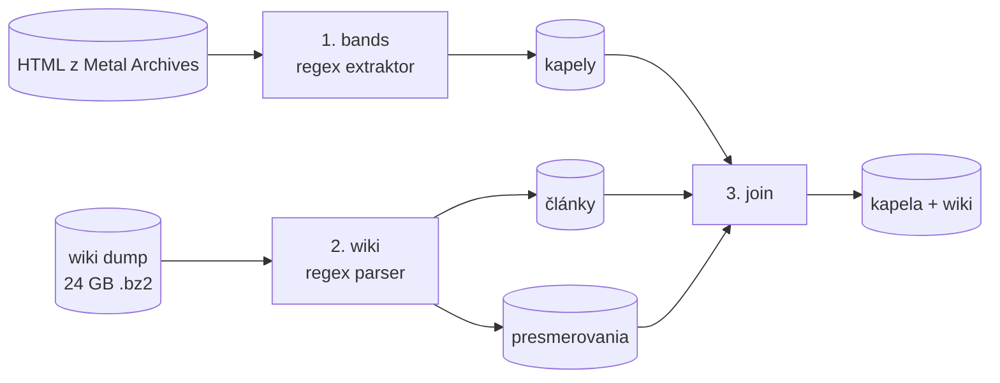
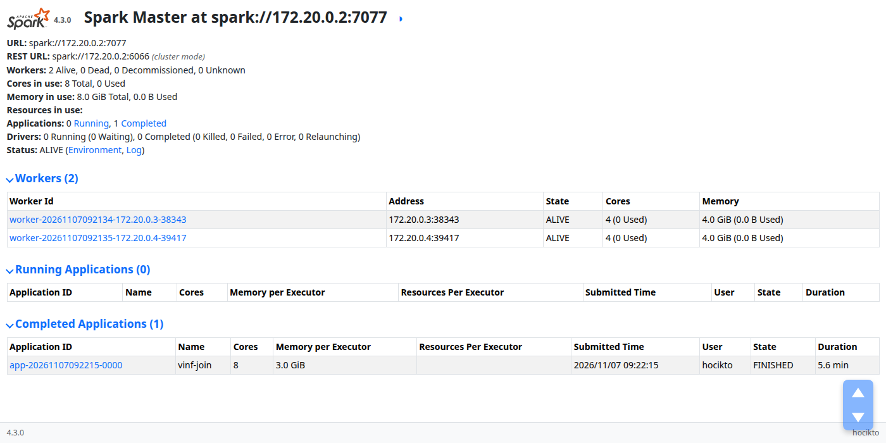
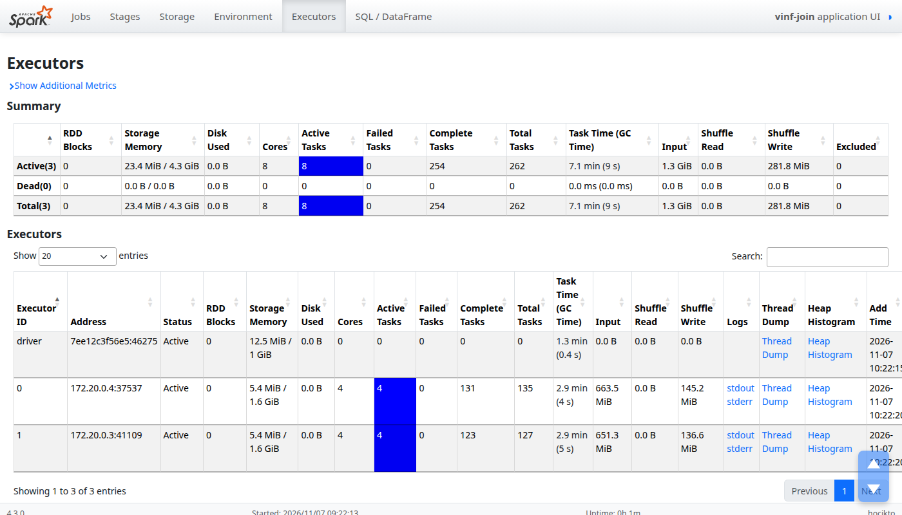

# Konzultácia 3: Spark, wiki dump a join

Repozitár: <https://github.com/K-o-m-A/vinf>

## 1. Prehľad

Od prvého odovzdania sme spracovanie dát presunuli do Apache Spark (PySpark). V Sparku teraz beží extrakcia kapiel z Metal Archives (ďalej MA), parsovanie anglického wiki dumpu aj join medzi nimi. Dump má 24 GB a čítame ho len regulárnymi výrazmi, XML parser nepoužívame. Výsledok: 3 905 kapiel z MA má pripojený článok z Wikipédie.

Kód je v priečinku `sparkjobs/`:

- [`jobs.py`](https://github.com/K-o-m-A/vinf/blob/main/sparkjobs/jobs.py): samotné Spark joby (kapely, wiki, join)
- [`wiki.py`](https://github.com/K-o-m-A/vinf/blob/main/sparkjobs/wiki.py): regexy, ktoré z wiki stránky vytiahnu infobox, členov, kategórie a úvodný odsek
- [`matching.py`](https://github.com/K-o-m-A/vinf/blob/main/sparkjobs/matching.py): bodovanie dvojice kapela × článok
- [`evaluate.py`](https://github.com/K-o-m-A/vinf/blob/main/sparkjobs/evaluate.py): kontrola joinu voči Wikidatám

Klaster je opísaný v [`docker-compose.yml`](https://github.com/K-o-m-A/vinf/blob/main/docker-compose.yml) a testy na reálnych článkoch sú v [`tests/test_wiki.py`](https://github.com/K-o-m-A/vinf/blob/main/tests/test_wiki.py).

## 2. Spracovanie v Sparku



Prvý krok je extraktor z 1. odovzdania, len namiesto `multiprocessing.Pool` ho teraz paralelne púšťa Spark nad ~201 tisíc HTML stránkami z MA.

Druhý krok číta wiki dump. Ten je jeden obrovský XML súbor, ale Hadoop ho vie čítať po záznamoch s vlastným oddeľovačom. Nastavili sme ho na `</page>`, takže jeden záznam je jedna wiki stránka. Formát bz2 je komprimovaný po blokoch, preto ho Spark rozdelí na 769 častí a spracuje paralelne bez rozbaľovania. Z dumpu si necháme články o hudobníkoch a skupinách a všetky presmerovania. Presmerovania sa hodia, lebo obsahujú staré a alternatívne mená kapiel, napríklad *Burn the Priest* vedie na *Lamb of God*.

Tretí krok je join (kapitola 4).

Rovnaký kód sme pustili aj na Spark klastri v Dockeri (master a dva workery po 4 jadrách) a join tam vyšiel presne rovnako ako lokálne. Rýchlejšie to nebolo: oba workery bežia na tom istom notebooku, takže klaster pridá len réžiu. Ide skôr o to, že kód beží distribuovane bez úprav.

| Krok | Lokálne (8 jadier) | Klaster |
|---|---|---|
| bands | 93 min | |
| wiki | 51 min | |
| join | 4,3 min | 5,6 min |





## 3. Práca s wiki dátami (REGEX)

Regexy sú v [`sparkjobs/wiki.py`](https://github.com/K-o-m-A/vinf/blob/main/sparkjobs/wiki.py). Tie hlavné:

| Regex | Na čo |
|---|---|
| `<title>(.*?)</title>`, `<redirect title="([^"]*)"` | titulok stránky, presmerovanie |
| `\{\{\s*Infobox[ _]+(?:musical[ _]+artist\|band\|musician)` | začiatok infoboxu |
| `^\s*\|\s*([A-Za-z_ ]+?)\s*=(.*?)(?=^\s*\|…=\|\Z)` | polia infoboxu, napr. `\| origin = Oslo, Norway` |
| `\[\[(?:[^\|\]]*\|)?([^\]]*)\]\]` | odkaz na text: `[[Euronymous\|Øystein Aarseth]]` dá *Øystein Aarseth* |
| `\[\[\s*Category\s*:\s*([^\|\]]+?)…\]\]` | kategórie |
| `\{\{\s*Short description\s*\|([^}\|]*)` | krátky popis, napr. *Norwegian black metal band* |
| `^==\s*(?:band\s+)?members\s*==` | sekcia so členmi v tele článku |
| `\s+[–—-]\s*\|\s*[(,:;]` | odreže nástroj a roky z mena člena: *Chuck Schuldiner – guitars (1995)* |
| `\b(?:band\|musical group\|…)\b` | pozná článok o skupine aj bez infoboxu (*Italian metal band*) |
| `established in (\d{4})` | rok vzniku z kategórie |

Najviac práce dali vnorené šablóny. Infobox často obsahuje ďalšie šablóny (`{{hlist|…}}`, citácie) a jeden regex nevie nájsť správnu koncovú `}}`. Koniec infoboxu preto hľadáme počítaním `{{` a `}}`. Pri úvodnom odseku zase opakovane mažeme najvnútornejšie šablóny, kým nejaké zostávajú.

Členov sme pôvodne brali len z infoboxu. Ukázalo sa však, že veľa článkov ho má bez členov (napr. *Control Denied*) a zoznam je až v sekcii *Members*. Odtiaľ ich teraz čítame tiež.

Takto vyzerá výstup pre *Mayhem (band)* (skrátené):

```json
{"title": "Mayhem (band)", "short_description": "Norwegian black metal band",
 "lead": "Mayhem is a Norwegian black metal band formed in Oslo in 1984. They were one of the pioneers …",
 "origin": "Oslo, Norway", "start_year": 1984, "genres": ["Black metal"],
 "labels": ["Deathlike Silence", "Season of Mist", "Century Media", "…"],
 "members": ["Necrobutcher", "Hellhammer", "Attila Csihar", "Teloch", "Ghul"],
 "past_members": ["Euronymous", "Dead", "Count Grishnackh", "…"]}
```

## 4. Join Metal Archives a Wikipédie

MA a Wikipédia nemajú spoločný identifikátor, takže spájame cez meno kapely. Meno najprv normalizujeme: bez diakritiky, medzier, interpunkcie a úvodného *The* (*Mötley Crüe* sa zmení na `motleycrue`). Článok môže mať viac mien: titulok, meno z infoboxu a všetky presmerovania. Kandidátov potom nájde obyčajný equi-join v Sparku.

Samotné meno nestačí. Len kapiel s menom *Mayhem* je na MA pätnásť. Každú dvojicu kapela × článok preto obodujeme podľa toho, čo sa zhoduje:

| Zhoda | Body |
|---|---|
| spoločný člen | 3 za každého, najviac 9 |
| krajina | 2 |
| rok vzniku (± 1 rok) | 2 |
| mesto | 1 |
| článok je o metale | 1 |

Dvojicu prijmeme pri skóre aspoň 7, alebo ak má kapela s článkom spoločného člena a sedí krajina. Pre články bez členov a pre sólo projekty je v [`matching.py`](https://github.com/K-o-m-A/vinf/blob/main/sparkjobs/matching.py) zopár výnimiek. Prah sme na začiatku mali 4, ale pri ručnej kontrole bola asi tretina dvojíc so skóre 4 až 6 zlá. Pripájali sa napríklad rapperi s rovnakým menom (*Bones* → *Bones (rapper)*). Nakoniec každý článok dostane najviac jednu kapelu a každá kapela najviac jeden článok.

Pre článok *Mayhem (band)* to vyzerá takto:

| Kapela na MA | Krajina | Vznik | Spoloční členovia | Skóre |
|---|---|---|---|---|
| Mayhem (id 67) | Norway | 1984 | 14 | 15, pripojená |
| Mayhem (id 7406) | United States | 1983 | 0 | 3 |
| Mayhem (id 54480) | Finland | 1983 | 0 | 3 |

Čísla z celého behu:

| | Počet |
|---|---|
| kapiel z MA | 201 389 |
| článkov z Wikipédie | 125 182 |
| kandidátnych dvojíc (rovnaké meno) | 45 493 |
| pripojených unikátnych wiki stránok | 3 905 |

Ako zistiť, či je join dobrý? Pri časti kapiel to vedia Wikidata: majú vlastnosť P1952, ktorá je id kapely na MA. Pre 3 409 našich kapiel tak poznáme správny článok. Join tieto údaje nepoužíva, slúžia len na kontrolu. Zhoda vyšla na 99,4 % našich dvojíc a join našiel 91,4 % dvojíc z Wikidát.

Najčastejšie join vynechá kapelu, pri ktorej sa zhoduje príliš málo (článok bez členov, iný rok vzniku), alebo kapelu zapísanú iným písmom (*唐朝* je na Wikipédii *Tang Dynasty*). Niektoré „chyby“ ani nie sú chyby. MA má pre kapely po premenovaní dva záznamy (*Idle Hands* a *Unto Others*) a Wikidata niekedy odkazujú na starý, zatiaľ čo my na nový.

## 5. Čo pridáva Wikipédia oproti Metal Archives

MA je v metale podrobnejšia: má celé zostavy s rokmi a nástrojmi, diskografiu, témy textov a stav kapely. V tom Wikipédia nič nové neprinesie a jej členov používame hlavne na overenie joinu. Pri 3 905 pripojených kapelách však pridáva veci, ktoré na MA vôbec nie sú.

Najdôležitejšia je popularita. Z MA sa nedá zistiť, že nórsky *Mayhem* je známejší ako jeho štrnásti menovci z Nemecka, Talianska či USA. Článok na Wikipédii má necelé 2 % kapiel z MA a sú to práve tie známe. Medzi nimi pomôže dĺžka článku: medián je 8 300 znakov, desatina najdlhších má cez 26 000.

Druhá vec je text. Úvodný odsek článku máme pri 99,7 % kapiel a je to súvislý popis kapely, vhodný do fulltextu aj ako popis vo výsledkoch. Poznámka pri kapele na MA má v priemere podobnú dĺžku (~320 znakov), no často je to len zoznam kompilácií alebo informácia o zmene mena.

Potom sú tu údaje, ktoré MA vedie len čiastočne. Vydavateľstvo má MA iba aktuálne alebo posledné, Wikipédia ich uvádza v priemere 2,3 a pri 2 686 kapelách je medzi nimi aspoň jedno, ktoré na MA nie je. Žánre MA eviduje len metalové, takže pri 2 411 kapelách Wikipédia pridá žáner navyše, najčastejšie *hard rock* (175 kapiel), *progressive rock* (63) a *stoner rock* (53).

Úplne nové sú vzťahy medzi kapelami. Polia *associated acts* a *spinoffs* má 786 kapiel (*Metallica* → *Megadeth*). Z 1 946 takých odkazov vedie 1 064 na inú kapelu, ktorú máme tiež pripojenú, takže sa z nich dá postaviť graf. K tomu oficiálny web pri 2 193 kapelách (v našej extrakcii z MA nie je) a kategórie, ktoré sú faktami v pevnom tvare: *Musical groups established in 1984*, *Roadrunner Records artists*, pri 76 kapelách aj ocenenia ako *Grammy Award winners*.

## 6. Atribúty z Wikipédie, ktoré nás zaujímajú

Pokrytie je podiel z 3 905 pripojených článkov, ktoré daný atribút majú.

| Atribút | Pokrytie | Na čo ho použijeme |
|---|---|---|
| článok a jeho dĺžka | 100 % | popularita pri zoraďovaní výsledkov |
| úvodný odsek | 99,7 % | fulltext, popis vo výsledkoch |
| kategórie | 100 % | rok vzniku, vydavateľstvá, ocenenia |
| žánre | 97,5 % | vyhľadávanie aj podľa nemetalových žánrov |
| krátky popis | 94,9 % | jedna veta k výsledku |
| pôvod (`origin`) | 92,8 % | mesto vzniku; na MA býva aktuálne sídlo |
| vydavateľstvá | 87,5 % | celá história vydavateľstiev |
| členovia | 82,6 % | overenie joinu, mená z Wikipédie (*Euronymous*) |
| web | 56,2 % | odkaz na oficiálnu stránku |
| súvisiace kapely | 11,8 % | podobné kapely, „kapely, ktoré vznikli z …“ |

## 7. Ďalej

Do 4. odovzdania pribudne index v PyLucene nad kapelami s týmito údajmi z Wikipédie a porovnanie so starým indexom. Na neskôr necháme popularitu z počtu odkazov a návštevnosti, graf vzťahov medzi kapelami, albumy z Wikipédie a články o členoch kapiel.

## 8. Spustenie

```bash
pip install -r requirements.txt   # pyspark, Java 17
aria2c -x2 -d data/wiki -o enwiki-latest-pages-articles.xml.bz2 \
    https://dumps.wikimedia.org/enwiki/latest/enwiki-latest-pages-articles.xml.bz2

python -m sparkjobs bands     # kapely z MA
python -m sparkjobs wiki      # wiki dump
python -m sparkjobs join      # join -> data/spark/bands_wiki, join_stats.json
python -m sparkjobs eval      # kontrola voči Wikidatám -> eval_stats.json

# na klastri
docker compose up -d
docker compose exec spark-master /opt/spark/bin/spark-submit \
    --master spark://spark-master:7077 --driver-memory 2g --executor-memory 3g run_spark.py join

python -m unittest discover -s tests -v
```
