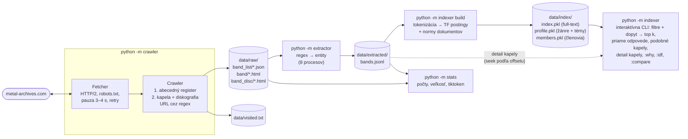
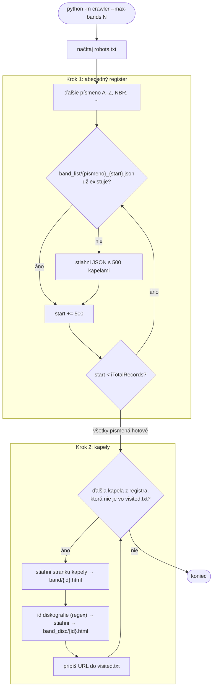

# Odovzdanie 1: crawler, extraktor, index

Repozitár: <https://github.com/K-o-m-A/vinf>

## 1. Opis projektu

Cieľom je vyhľadávač nad hudobnými interpretmi z metalovej scény. Dáta zbierame z **Encyclopaedia Metallum** (www.metal-archives.com), najväčšej databázy metalových kapiel. Pôvodne sme plánovali last.fm, ale ten začiatkom októbra 2026 nasadil anti-bot ochranu (podrobnosti v [Konzultácii 2](konzultacia2.md)). Používateľ zadá anglický dopyt (napr. *„black metal satanism norway"*) a dostane zoradený zoznam kapiel s ich údajmi: krajinou, žánrom, zostavou a diskografiou. V druhej fáze sa kapely napárujú na články z Wikipédie (cez meno a krajinu) a doplnia sa o fakty, ktoré Metal Archives nemá.

Hotové v tejto fáze:

1. **Crawler** stiahol celý abecedný register (419 strán JSON) a pre každú kapelu hlavnú stránku a diskografiu.
2. **Extraktor** z HTML pomocou regulárnych výrazov vyberie 13 polí kapely, zostavu (aktuálni, bývalí, live) a diskografiu.
3. **Indexer** je vlastný invertovaný index (TF) s tromi metódami výpočtu IDF a kosínusovým rankovaním. K nemu patrí **interaktívna CLI aplikácia** na kladenie otázok a prezeranie výsledkov. Rozpoznáva filtre v otázke (krajina, rok vzniku, stav, žáner), priamo odpovedá na otázky o zostave, kapelách hudobníka či najlepšom albume a hľadá podobné kapely.
4. **Štatistika** zahŕňa počet, veľkosť a relevantnosť dokumentov a počet tokenov (tiktoken).
5. **Unit testy** overujú REGEX extraktory na 20 reálnych stránkach.

## 2. Scrapované stránky a extrahované dáta

| Stránka | URL | Čo z nej berieme |
|---|---|---|
| Abecedný register (JSON) | `https://www.metal-archives.com/browse/ajax-letter/l/{A–Z,NBR,~}/json/1?iDisplayStart=…` | URL kapely, meno, krajina, žáner, stav |
| Stránka kapely | napr. <https://www.metal-archives.com/bands/Opeth/38> | meno, krajina, lokalita, stav, rok vzniku, roky aktivity, žáner, témy textov, label, popis, zostava (meno, nástroj, roky) |
| Diskografia | napr. <https://www.metal-archives.com/band/discography/id/38/tab/all> | názov vydania, typ, rok, počet recenzií, priemerné hodnotenie |

**5 ukážok extrahovaných dát** (skrátené, z `data/extracted/bands.jsonl`):

| Kapela | Krajina / lokalita | Vznik / stav | Žánre (normalizované) | Témy | Label | Členovia (akt./bývalí/live) | Vydania (prvé) |
|---|---|---|---|---|---|---|---|
| [Metallica](https://www.metal-archives.com/bands/Metallica/125) | United States / Los Angeles/San Francisco, California | 1981 / Active | Thrash Metal, Hard Rock, Heavy Metal | Introspection, Anger, Corruption, … | Blackened Recordings | 4 / 4 / 4 (Lars Ulrich – Drums 1981-present) | 941 (No Life 'til Leather, Demo, 1982, 10 recenzií, 87 %) |
| [Opeth](https://www.metal-archives.com/bands/Opeth/38) | Sweden / Sörskogen, Stockholm | 1990 / Active | Progressive Death Metal, Progressive Rock | Nature, Death, Love, … | Reigning Phoenix Music | 5 / 16 / 6 (Mikael Åkerfeldt – Guitars 1990-present, Vocals (lead) 1992-present) | 47 (Orchid, Full-length, 1995, 28, 84 %) |
| [Burzum](https://www.metal-archives.com/bands/Burzum/88) | Norway / Bergen, Vestland (early); … | 1991 / Active | Black Metal, Ambient | Mythology, Folklore, Odalism | Byelobog Productions | 1 / 0 / 0 (Varg Vikernes – Everything) | 35 (Demo I, Demo, 1991, 9, 75 %) |
| [Sepultura](https://www.metal-archives.com/bands/Sepultura/78) | Brazil / Belo Horizonte, Minas Gerais (early); São Paulo (later) | 1984 / Active | Death Metal, Thrash Metal, Nu-Metal, Groove Metal | Satanism, Death, Evil (early), … | Nuclear Blast Records | 4 / 11 / 7 | 85 (Bestial Devastation / Século XX, Split, 1985) |
| [Black Sabbath](https://www.metal-archives.com/bands/Black_Sabbath/99) | United Kingdom / Birmingham, West Midlands, England | 1969 / Split-up | Heavy Metal, Doom Metal | Doom, Drugs, Life, … | Vertigo Records | 4 / 21 / 8 | 166 (Evil Woman, Single, 1970, 2, 88 %) |

Jeden celý záznam (Opeth, zoznamy skrátené na 2–3 položky):

```json
{
  "url": "https://www.metal-archives.com/bands/Opeth/38",
  "name": "Opeth", "id": 38, "country": "Sweden", "location": "Sörskogen, Stockholm",
  "status": "Active", "formed": 1990, "years": [["1990", "present"]],
  "genre": "Progressive Death Metal, Progressive Rock",
  "genres": ["Progressive Death Metal", "Progressive Rock"],
  "themes": ["Nature", "Death", "Love", "Heartbreak", "Sorrow", "Seasons", "Occultism"],
  "label": "Reigning Phoenix Music",
  "comment": "Opeth is a name taken from the novel Sunbird by author Wilbur Smith ...",
  "members": {
    "current": [{"id": 144, "name": "Mikael Åkerfeldt", "role": "Guitars, Vocals (lead)",
                 "roles": [["Guitars", "1990-present"], ["Vocals (lead)", "1992-present"]],
                 "url": "https://www.metal-archives.com/artists/Mikael_%C3%85kerfeldt/144"}],
    "past": [{"id": 180, "name": "Nick Döring", "role": "Bass", "roles": [["Bass", "1990-1991"]]}],
    "live": [{"id": 685, "name": "Gene Hoglan", "role": "Drums", "roles": [["Drums", "2004"]]}]
  },
  "releases": [
    {"id": 138, "name": "Orchid", "type": "Full-length", "year": 1995, "reviews": 28, "rating": 84},
    {"id": 137, "name": "Morningrise", "type": "Full-length", "year": 1996, "reviews": 23, "rating": 72}
  ]
}
```

## 3. Otázky a odpovede, ktoré má systém zvládnuť

Odpovede sú z našich vycrawlovaných dát.

| # | Otázka | Očakávaná odpoveď | Z čoho sa odpovedá |
|---|---|---|---|
| 1 | Who are the current members of Metallica? | Lars Ulrich (drums), James Hetfield (vocals, rhythm guitar), Kirk Hammett (lead guitar), Robert Trujillo (bass) | `members.current` |
| 2 | When was Master of Puppets released and how is it rated? | 1986, full-length, 45 recenzií, priemer 81 % | `releases` (diskografia) |
| 3 | Which metal bands are from Armenia? | 53 kapiel, najrecenzovanejšie Ildaruni, Sworn, Rampant Beast, Blood Covenant | filter `country`, zoradené podľa počtu recenzií |
| 4 | Brazilian thrash metal bands formed in the 1980s? | 305 kapiel; najrecenzovanejšie Sepultura (1984), Sarcófago (1985), Vulcano (1981), Holocausto | filtre `country` + `genres` + `formed`, zoradené podľa počtu recenzií |
| 5 | What is the best rated Opeth full-length album? | Still Life (1999, 86 %), Deliverance (2002, 85 %), Orchid (1995, 84 %) | `releases.rating`, `reviews` |
| 6 | Norwegian black metal bands that sing about satanism? | 100 kapiel, napr. A.A.N, Balthamel, Nocturnal Ritual, Blodshunger | filtre `country` + `genres`, zvyšok („satanism") full-text index, téma v `themes` |
| 7 | Which bands did Dave Mustaine play in? | Megadeth (Guitars, Vocals 1983–2002, 2004–present), MD.45, DeuxMonkey, Metallica (past, Guitars (lead) 1982–1983), Red Lamb | index členov (meno → id umelca → kapely) |
| 8 | Similar bands to Kanonenfieber? | God Dethroned, Neige et Noirceur, 1914, Torchbearer, Minenwerfer (všetky spievajú o 1. svetovej vojne) | profilový index žánrov a tém (kap. 10) |

## 4. Frameworky a knižnice

| Časť | Nástroj | Prečo |
|---|---|---|
| Jazyk | Python 3.12 | |
| HTTP | `httpx[http2]` | Cloudflare pred Metal Archives vracia challenge každému HTTP/1.1 klientovi (aj `requests`, `curl --http1.1`), cez HTTP/2 stránky prechádzajú |
| robots.txt | `urllib.robotparser` (štandardná knižnica) | kontrola `Disallow` a `Crawl-delay` |
| Extrakcia URL a entít | `re` (štandardná knižnica) | zadanie vyžaduje vlastné regexy, bez BeautifulSoup/Scrapy |
| Paralelizácia | `multiprocessing` (štandardná knižnica) | extrakcia ~400 000 súborov za ~40 s na 8 jadrách |
| Index | vlastná implementácia (`dict` + `array`, `pickle`) | zadanie vyžaduje vlastný indexer; `array('I')` drží 7,2 mil. postingov kompaktne (~580 MB RAM) |
| Tokeny | `tiktoken` (kódovanie `o200k_base`) | bonus: počet tokenov v štatistike |
| Testy | `unittest` (štandardná knižnica) | žiadna ďalšia závislosť |

Jediné externé závislosti sú `httpx` a `tiktoken` ([requirements.txt](https://github.com/K-o-m-A/vinf/blob/main/requirements.txt)).

## 5. Architektúra systému



Crawler beží v dvoch krokoch. Poradie stránok je dané (register → kapela → jej diskografia), takže nepotrebuje všeobecný front URL:



- **Stav crawlera** je iba `data/visited.txt` (jedna URL na riadok). Crawl sa dá kedykoľvek prerušiť a pokračuje tam, kde skončil.
- **Id kapely** sa berie zo stránky (z odkazu na diskografiu), nie z URL. Metal Archives totiž zobrazí kapelu aj podľa mena s nesprávnym id a diskografia z takého id by vrátila 404.
- **Blokovanie:** ak server vráti anti-bot stránku („Client Challenge", „Just a moment…"), crawler ju neuloží a skončí.

| Súbor | Úloha |
|---|---|
| [`crawler/config.py`](https://github.com/K-o-m-A/vinf/blob/main/crawler/config.py) | hlavičky, timeouty, pauzy, cesty |
| [`crawler/fetcher.py`](https://github.com/K-o-m-A/vinf/blob/main/crawler/fetcher.py) | HTTP klient, robots.txt, rate limiting, retry, detekcia blokovania |
| [`crawler/crawler.py`](https://github.com/K-o-m-A/vinf/blob/main/crawler/crawler.py) | krok 1 a 2, extrakcia URL regexom |
| [`extractor/extract.py`](https://github.com/K-o-m-A/vinf/blob/main/extractor/extract.py) | REGEX extrakcia entít |
| [`indexer/index.py`](https://github.com/K-o-m-A/vinf/blob/main/indexer/index.py) | invertovaný index, metódy IDF, vyhľadávanie |
| [`indexer/query.py`](https://github.com/K-o-m-A/vinf/blob/main/indexer/query.py) | rozbor otázky: filtre (krajina, rok vzniku, stav, žáner) a typ otázky |
| [`indexer/cli.py`](https://github.com/K-o-m-A/vinf/blob/main/indexer/cli.py) | interaktívna CLI aplikácia |
| [`stats/__main__.py`](https://github.com/K-o-m-A/vinf/blob/main/stats/__main__.py) | štatistika a tokeny |
| [`tests/test_extractor.py`](https://github.com/K-o-m-A/vinf/blob/main/tests/test_extractor.py) | unit testy extraktorov |
| [`tests/test_query.py`](https://github.com/K-o-m-A/vinf/blob/main/tests/test_query.py) | unit testy rozboru otázok a tokenizácie |

## 6. Metadáta ukladané pri crawlovaní

HTTP metadáta (hlavičky, status, čas odpovede) samostatne neukladáme. Ukladáme len odpovede so statusom 200, všetky majú rovnaký `Content-Type` (`text/html; charset=UTF-8`, resp. JSON pre register) a čas stiahnutia je zachytený v čase úpravy súboru. Ostatné chyby (404, timeouty) sa iba zalogujú a kapela sa nezapíše do `visited.txt`, takže sa pri ďalšom behu skúsi znova. Metadátami kapiel sú riadky abecedného registra (meno, URL, krajina, žáner, stav), ktoré si ukladáme ako JSON ešte pred stiahnutím stránok. K nim pribúda `visited.txt` a mená/veľkosti/časy uložených súborov:

| Meno | URL (`visited.txt`) | Krajina | Žáner (z registra) | Stav | Súbor registra | Stránka kapely | Diskografia | Stiahnuté |
|---|---|---|---|---|---|---|---|---|
| Metallica | https://www.metal-archives.com/bands/Metallica/125 | United States | Thrash Metal (early); Hard Rock (mid); Heavy/Thrash Metal (later) | Active | M_006000.json | band/125.html (34.9 KB) | band_disc/125.html (326.6 KB) | 2026-10-13 17:15 |
| Opeth | https://www.metal-archives.com/bands/Opeth/38 | Sweden | Progressive Death Metal, Progressive Rock | Active | O_002500.json | band/38.html (65.8 KB) | band_disc/38.html (16.2 KB) | 2026-10-15 06:24 |
| Burzum | https://www.metal-archives.com/bands/Burzum/88 | Norway | Black Metal, Ambient | Active | B_011000.json | band/88.html (15.8 KB) | band_disc/88.html (12.0 KB) | 2026-10-06 05:51 |
| Sepultura | https://www.metal-archives.com/bands/Sepultura/78 | Brazil | Death/Thrash Metal (early); Nu-Metal, Groove/Thrash Metal (later) | Active | S_006000.json | band/78.html (55.3 KB) | band_disc/78.html (27.5 KB) | 2026-10-17 04:49 |
| Black Eucharist | https://www.metal-archives.com/bands/Black_Eucharist/3540453125 | United States | Black Metal | Active | B_004000.json | band/3540453125.html (19.0 KB) | band_disc/3540453125.html (0.7 KB) | 2026-10-05 16:12 |

## 7. Hlavičky, timeouty, pauzy

| Nastavenie | Hodnota | Prečo |
|---|---|---|
| `User-Agent` | `vinf-crawler/0.1 (+FIIT STU VINF school project)` | poctivo sa identifikujeme ako crawler; admin vie, kto sťahuje a prečo |
| `Accept` | `text/html,application/xhtml+xml;q=0.9,*/*;q=0.8` | chceme HTML; JSON registra prejde cez `*/*` |
| `Accept-Language` | `en-US,en;q=0.8` | stránky sú po anglicky, dopyty budú tiež |
| `Accept-Encoding` | `gzip, deflate` | menší prenos (HTML sa komprimuje ~5–10×) |
| Protokol | HTTP/2 | Cloudflare blokuje HTTP/1.1 klientov |
| Timeout | 10 s pripojenie, 30 s čítanie | pripojenie trvá bežne < 1 s; register s 500 riadkami alebo diskografia Metallicy (326 KB) sa generuje na serveri niekoľko sekúnd |
| Pauza | 3 s + náhodne 0–1 s od začiatku poslednej požiadavky | `Crawl-delay: 3` v robots.txt; náhodná zložka, aby požiadavky nechodili v presnom rytme |
| Opakovanie | max. 3× pri chybe spojenia, timeoute, 429 a 5xx; čakanie 10 → 20 → 40 s alebo podľa `Retry-After` | exponenciálny backoff, preťaženému serveru dáme čas |
| 404 a iné chyby | zalogujú sa, crawler pokračuje | jedna chybná kapela nezastaví crawl |

Pri ~3,5 s na požiadavku je to ~1 000 stránok za hodinu, teda ~500 kapiel (2 stránky na kapelu). Celý crawl trval ~17 dní (3. – 20. 10. 2026).

## 8. Kód: extrakcia URL z HTML

[`crawler/crawler.py#L22-L24`](https://github.com/K-o-m-A/vinf/blob/main/crawler/crawler.py#L22-L24), použitie v [`band_urls()`](https://github.com/K-o-m-A/vinf/blob/main/crawler/crawler.py#L74-L79) a [`crawl_bands()`](https://github.com/K-o-m-A/vinf/blob/main/crawler/crawler.py#L100-L104):

```python
BAND_LINK = re.compile(r"href='(https://www\.metal-archives\.com/bands/[^']+/\d+)'")
# id v URL nemusi sediet (stranka sa najde aj podla mena), skutocne id je v odkaze na diskografiu
BAND_ID_IN_PAGE = re.compile(r"/band/discography/id/(\d+)/tab/all")


def band_urls():
    for path in sorted((config.RAW_DIR / "band_list").glob("*.json")):
        for row in json.loads(path.read_text(encoding="utf-8"))["aaData"]:
            link = BAND_LINK.search(row[0])
            if link:
                yield html.unescape(link.group(1))

# v crawl_bands():
        m = BAND_ID_IN_PAGE.search(page)
        if m:
            disc = download(fetcher, f"{config.BASE_URL}/band/discography/id/{m.group(1)}/tab/all")
```

`BAND_LINK` vytiahne URL kapely z HTML fragmentu v riadku registra (`<a href='https://www.metal-archives.com/bands/Metallica/125'>Metallica</a>`). `html.unescape` opraví entity v menách (`Guns_N&#039;_Roses`). `BAND_ID_IN_PAGE` nájde na stránke kapely odkaz na kompletnú diskografiu a z neho skutočné id.

## 9. Kód: extrakcia entít z HTML

[`extractor/extract.py`](https://github.com/K-o-m-A/vinf/blob/main/extractor/extract.py), regulárne výrazy [`#L10-L31`](https://github.com/K-o-m-A/vinf/blob/main/extractor/extract.py#L10-L31):

```python
BAND_NAME = re.compile(r'<h1 class="band_name[^"]*">\s*<a href="([^"]+)">(.*?)</a>', re.S)
BAND_ID = re.compile(r"/band/discography/id/(\d+)/tab/all")
# <dt>Genre:</dt> <dd>...</dd>; obsah dd moze obsahovat odkazy, preto .*? s re.S
STAT = re.compile(r"<dt>([^<]+?):</dt>\s*<dd[^>]*>(.*?)</dd>", re.S)
COMMENT = re.compile(r'<div class="band_comment[^"]*">(.*?)(?:<div class="tool_strip|</div>)', re.S)
# sekcia jednej zostavy: od jej <div id=...> po koniec tabulky, dalsiu sekciu alebo "(None)"
LINEUP_SECTION = r'<div id="band_tab_members_{}">(.*?)(?:</table>|<div id="band_tab_members_|<em>\(None\)</em>)'
LINEUP_ROW = re.compile(
    r'<tr class="lineupRow">.*?<a href="(https://www\.metal-archives\.com/artists/[^"]+/(\d+))"[^>]*>(.*?)</a>'
    r".*?<td>\s*(.*?)\s*</td>", re.S)
RELEASE_ROW = re.compile(
    r'<tr>\s*<td><a href="(https://www\.metal-archives\.com/albums/[^"]+/(\d+))"[^>]*>(.*?)</a></td>'
    r'\s*<td[^>]*>(.*?)</td>\s*<td[^>]*>(\d{4})</td>(.*?)</tr>', re.S)
REVIEWS = re.compile(r">(\d+) \((\d+)%\)</a>")
YEAR_RANGE = re.compile(r"(\d{4}|\?)\s*-\s*(\d{4}|present|\?)")
# "Bass&nbsp;(1975-present), Keyboards&nbsp;(1997-present)": roky su za &nbsp; (\xa0),
# zatvorky v nastroji ("Vocals (lead)") maju obycajnu medzeru
ROLE_PART = re.compile(r"\s*(.+?)\xa0\(([^)]*)\)\s*,?")
```

Hlavná funkcia [`extract_band()`](https://github.com/K-o-m-A/vinf/blob/main/extractor/extract.py#L97-L123):

```python
def extract_band(page):
    """Stranka kapely -> dict s entitami. Ak to nie je stranka kapely, vrati None."""
    m = BAND_NAME.search(page)
    if not m:
        return None
    band = {"url": m.group(1), "name": clean(m.group(2))}
    id_match = BAND_ID.search(page)
    band["id"] = int(id_match.group(1)) if id_match else int(band["url"].rsplit("/", 1)[1])

    for key, value in STAT.findall(page):
        field = FIELDS.get(key.strip())
        if field and field not in band:
            band[field] = clean(value)

    formed = band.get("formed", "")
    band["formed"] = int(formed) if formed.isdigit() else None
    band["genres"] = split_genres(band.get("genre", ""))
    band["themes"] = [] if band.get("themes", "N/A") in EMPTY else split_list(band["themes"], r"[,;]")
    band["years"] = [list(r) for r in YEAR_RANGE.findall(band.get("years_active", ""))]
    ...
    band["members"] = {s: parse_members(page, s) for s in ("current", "past", "live")}
    return band
```

Zaujímavé prípady, na ktoré sme pri extrakcii narazili (všetky sú pokryté testami):

- **`class="band_name noCaps"`**: kapely s gréckymi písmenami v mene (*Carcharoth Λ.V.*, *3η Εποχή*) majú v `<h1>` ďalšiu triedu. Prvá verzia regexu ich (19 stránok) nenašla.
- **Žánre** ako `Black/Death Metal (early); Doom Metal` normalizujeme na `["Black Metal", "Death Metal", "Doom Metal"]` ([`split_genres()`](https://github.com/K-o-m-A/vinf/blob/main/extractor/extract.py#L63-L76)). Prípona „Metal" sa doplní iba známym prívlastkom (Black, Death, Heavy…). `Metalcore/Alternative Rock` tak neskončí ako „Metalcore Rock".
- **Roky členov:** v HTML je `Bass&nbsp;(1975-present), Keyboards&nbsp;(1997-present)`, ale aj `Vocals (lead), Guitars (rhythm)&nbsp;(1981-present)`. Roky od upresnenia nástroja odlíšime podľa `&nbsp;` pred zátvorkou.
- **Roky aktivity s pôvodným menom:** `2018-2021 (as <a href=…>Black Ejaculate</a>), 2021-present`.

Výsledok: **0 stránok zlyhalo** zo všetkých stiahnutých.

## 10. Indexer a index (TF)

[`indexer/index.py`](https://github.com/K-o-m-A/vinf/blob/main/indexer/index.py)

- **Dokument = kapela.** Text dokumentu ([`band_text()`](https://github.com/K-o-m-A/vinf/blob/main/indexer/index.py#L59-L67)) spája meno, krajinu, lokalitu, žánre, témy, label, stav, mená všetkých členov, názvy všetkých vydaní a popis kapely.
- **Tokenizácia:** malé písmená, regex `\w+` (Unicode, takže zachová aj `Λ`), **odstránenie diakritiky** (`Sarcófago` → `sarcofago`, dopyt „Sarcofago" tak nájde kapelu), **jednoduché odstránenie množného čísla** (`vikings` → `viking`, nie pri koncovkách -ss/-us/-is) a odstránenie krátkeho zoznamu anglických stop slov a jednopísmenových slov.
- **Invertovaný index:** `term → array('I')` so striedajúcimi sa hodnotami `[doc_id, tf, doc_id, tf, …]`. V postingoch je iba **TF** (počet výskytov termu v dokumente). `df` je dĺžka zoznamu postingov.
- **IDF sa neukladá:** počíta sa pri dopyte z `df` a `N`. Jeden index tak slúži pre všetky metódy IDF. Pri vytvorení sa pre každú metódu predpočíta iba norma (dĺžka) vektora každého dokumentu, ktorú potrebuje kosínusová podobnosť.
- **Váhovanie:** `w(t,d) = (1 + log10 tf) · idf(t)`, rovnako pre dopyt; skóre je kosínus medzi vektorom dopytu a dokumentu.
- **Koľkokrát ho vytvárame:** index sa vytvára **raz**, dávkovo (`python -m indexer build`), z `bands.jsonl` a uloží sa do `data/index/index.pkl`. Vyhľadávanie ho iba načíta. Znovu sa vytvára len po novom behu extraktora (napr. po docrawlovaní ďalších kapiel). Inkrementálne pridávanie by šlo (`Index.add`), ale normy dokumentov závisia od `N` a `df`, takže by sa aj tak musel prepočítať celý.

| | Hodnota |
|---|---|
| Dokumentov (N) | 198 653 |
| Unikátnych termov | 500 368 |
| Postingov (dvojíc term–dokument) | 7 237 568 |
| Čas vytvorenia | 35–39 s (1 proces); s profilovým indexom (16 s) a indexom členov (15 s) spolu ~70 s |
| Veľkosť na disku | 110 MB (`index.pkl`), 48 MB (`profile.pkl`, 24 045 termov), 60 MB (`members.pkl`, 593 727 mien) |
| Pamäť pri vytváraní | ~1,1 GB (špička celého `build` so všetkými tromi indexmi) |

### Interaktívna CLI aplikácia

`python -m indexer` spustí interaktívne vyhľadávanie (výstup je v angličtine) ([`indexer/cli.py`](https://github.com/K-o-m-A/vinf/blob/main/indexer/cli.py)). Používateľ píše otázky alebo kľúčové slová po anglicky a s výsledkami ďalej pracuje:

| Vstup | Čo urobí |
|---|---|
| `<otázka / dopyt>` | Z otázky odstráni opytovacie a výplňové slová („which", „bands", „sing about"…), vypíše, čo naozaj hľadá, a zobrazí top k kapiel. Kapela, ktorej meno presne zodpovedá dopytu, je navrchu (označená „presna zhoda mena"). Zvyšok je zoradený podľa TF-IDF. |
| `<číslo>` | Úplný detail kapely bez skracovania: krajina, stav, roky, žánre, témy, label, všetci členovia s nástrojmi a rokmi, celá diskografia s hodnoteniami, najlepšie hodnotený album, popis. Načíta sa z `bands.jsonl` cez offset uložený v indexe. |
| Enter / `:more` | ďalšia strana výsledkov |
| `:why <číslo>` | prečo je kapela vo výsledkoch: celý text polí, kde sa slová dopytu nachádzajú (zvýraznené), a tf, df, idf a príspevok každého termu ku kosínusovému skóre |
| `:idf classic\|smooth\|squared` | prepne metódu IDF a zopakuje posledný dopyt |
| `:compare [dopyt]` | top k všetkých troch metód IDF vedľa seba |
| `which band has an album named <názov>`, `who released <názov>` | kapely s vydaním daného názvu. Kandidáti sú prienik postingov všetkých slov názvu, potom sa overia názvy ich vydaní. Presná zhoda názvu je prvá. Bez tohto režimu by full-text na otázku *„Which band has an album named Besnota"* dal na 1. miesto kapelu, ktorej popis obsahuje slová „album" a „named". |
| `similar bands to <meno>`, `bands like <meno>`, `:similar <číslo>` | podobné kapely podľa žánru a lyrických tém (pozri nižšie) |
| `:k <n>`, `:help`, `:quit` | počet výsledkov na stranu, nápoveda, koniec |

Odstraňovanie výplňových slov vzniklo z reálneho problému. Na otázku *„Which black metal bands from Norway sing about satanism?"* vyšla na 1. miesto japonská kapela STF団. `:why 1` ukázal, že celé skóre dal zriedkavý term „sing" (jej album *Sing for You*). Teraz sa z otázky najprv rozpoznajú filtre (krajina Norway, žáner black, pozri nižšie) a full-textom sa hľadá iba zvyšok, „satanism". Výsledkom je 100 nórskych black metalových kapiel so satanizmom v textoch.

```
[classic] > Which black metal bands from Norway sing about satanism?
filters: country = Norway, genre has black   words: satanism
100 results in 85 ms, idf=classic
  1. A.A.N (Norway, formed 2025)  Black Metal  score 0.307
       matched in: themes (satanism)
  2. Balthamel (Norway, formed ?)  Black Metal  score 0.201
       matched in: themes (satanism)
  ...
[classic] > :why 1
A.A.N  query: 'satanism'
  Where the query words occur
    satanism in themes (once):
      Satanism
  Score  (idf=classic, document length |d| = 4.99)
    term               tf       df     idf  contribution
    satanism            1    5,837   1.532        0.3071
    score (cosine)                                 0.3071

[classic] > metallica
255 results in 1 ms, idf=classic
  1. Metallica (United States, formed 1981)  Thrash Metal (early); ...  exact name match
       matched in: name (metallica); release title (metallica 823x); description (metallica)
  2. Terminal Velocity (United States, formed ?)  Thrash Metal  score 0.310
       matched in: description (metallica)
  3. Castle of Pain (Canada, formed ?)  Doom/Thrash Metal  score 0.251
       matched in: description (metallica 4x)
```

Pri každom výsledku CLI vypíše, **v ktorom poli** sa slová dopytu našli. Napr. *Castle of Pain* sa pri dopyte „metallica" objaví preto, lebo jej popis 4× spomína Metallicu (cover „King Nothing" na dvoch tribute albumoch). Jej krátky dokument s vysokým tf preto dostane vysoké kosínusové skóre.

### Filtre a priame odpovede

Prvé verzie CLI brali každé slovo otázky ako slovo na full-textové hľadanie. Pri otázkach s podmienkami to zlyhávalo:
- *„thrash metal bands from Brazil formed in the 1980s"* dala nemecké a americké kapely, ktoré majú v popise slovo „1980s".
- *„swedish death metal"* hľadala „swedish" iba v popisoch, nie v poli krajiny.
- *„Which bands did Dave Mustaine play in?"* dala iných ľudí s priezviskom Mustaine.

Rozbor otázky je preto v samostatnom module [`indexer/query.py`](https://github.com/K-o-m-A/vinf/blob/main/indexer/query.py), pokrytom unit testami ([`tests/test_query.py`](https://github.com/K-o-m-A/vinf/blob/main/tests/test_query.py)).

**Filtre** sa z otázky rozpoznajú regulárnymi výrazmi a uplatnia sa tvrdo na extrahované polia. Zvyšné slová sa rankujú cez TF-IDF. Ak žiadne nezostanú, výsledky sa zoradia podľa popularity (počtu recenzií).

| Filter | Príklady v otázke | Pole |
|---|---|---|
| krajina | *from Brazil*, *swedish*, *norwegian*, *USA*, *korean* (tabuľka prídavných mien a skratiek → názov krajiny v Metal Archives) | `country` |
| rok vzniku | *formed in 1991*, *in the 1980s*, *late 90s*, *before 1995*, *since 2010*, *between 1985 and 1990* | `formed` |
| stav | *active*, *split-up*, *disbanded*, *on hold*, *changed name* | `status` |
| žáner | postupnosť žánrových slov končiaca na *metal/rock/punk* alebo samostatný žáner (*grindcore*, *thrash*…). Nie za „about": v *„sing about death"* je „death" téma. | `genres` |

| Otázka | Výsledok |
|---|---|
| thrash metal bands from Brazil formed in the 1980s | filters: country = Brazil, formed 1980-1989, genre has thrash → 305 kapiel: Sepultura, Sarcófago, Vulcano, Holocausto, … |
| swedish death metal | country = Sweden, genre has death → Opeth, In Flames, Katatonia, Amon Amarth, … |
| norwegian black metal before 1995 | Darkthrone, Mayhem, Dimmu Borgir, Burzum, Immortal, … |
| active black metal bands from Slovakia | Malokarpatan, Death Karma, Krolok, Aeon Winds, … |

**Priame odpovede:** otázky o konkrétnej kapele alebo osobe sa nehľadajú full-textom. CLI odpovedá priamo z extrahovaných polí:

| Otázka | Odpoveď |
|---|---|
| Who are the members of Metallica? | aktuálna, bývalá a live zostava s nástrojmi a rokmi |
| Which bands did Dave Mustaine play in? | Megadeth, MD.45, DeuxMonkey, Metallica (past member: Guitars (lead) 1982–1983), Red Lamb. Z **indexu členov** (`data/index/members.pkl`: meno bez diakritiky → id umelca, kapela, zostava, nástroje), rôznych ľudí s rovnakým menom rozlíši id umelca. |
| What is the best rated album of Opeth? | Still Life (1999, 86 % z 26 recenzií), potom ostatné albumy podľa hodnotenia. Albumy s 1–2 recenziami sú zvlášť (hodnotenie je menej spoľahlivé). |
| Where is Burzum from? / When was Slayer formed? | lokalita, krajina, rok vzniku, stav, roky aktivity |
| discography of X / albums by X | celá diskografia |

**Preklepy:** ak žiadna kapela nemá napísané meno, CLI ponúkne kapely s podobným menom (`difflib`, rovnaké prvé písmeno, dĺžka ±2): *„Metalica"* → *Did you mean: Metallica, Metalia, Metabolica?*

### Podobné kapely

Otázky typu *„Similar bands to Kanonenfieber"*, *„bands like 1914"* alebo príkaz `:similar <číslo>` sa nevyhľadávajú full-textom. V plnom texte by sa našli kapely, ktoré majú album s názvom „Kanonenfieber", alebo kapely, ktorých popis obsahuje slovo „similar". Pri `python -m indexer build` sa preto vytvára druhý, malý **profilový index** (`data/index/profile.pkl`) iba zo **žánrov a lyrických tém** kapely:

- **Termy:** slová a **dvojice slov v rámci jednej frázy** („World War I" → `world`, `war`, `world_war`, `war_i`). Dvojice odlíšia „World War I" od „New World Order" či „World hunger", ktoré zdieľajú iba slovo „world". Témy majú v profile dvojnásobnú váhu (hovoria, o čom kapela spieva). Odstraňuje sa jednoduché množné číslo (`wars` → `war`).
- **Pokrytie namiesto kosínusu:** profil pôvodnej kapely je dopyt s váhami `(1 + log10 tf) · idf`. Skóre kandidáta je podiel váhy (súčtu `w²`) profilu, ktorý má aj kandidát. Kosínus sme skúšali najprv: kapela 1914 (témy *World War I, Trench warfare, Gas attacks, Violence, Shell shock*) bola až **6 778.** Jej ďalšie zriedkavé témy predlžujú vektor, takže stovky kapiel s jedinou témou „World War I" ju predbehli. Pokrytie kandidáta za témy navyše netrestá.
- **Popularita:** `skóre = pokrytie · (1 + 0,15 · log10(1 + počet recenzií))`. Pri rovnakom pokrytí mierne zvýhodní známe kapely pred kapelami s jedným demom.

| # | Podobné ku **Kanonenfieber** (Melodic Black/Death Metal; World War I) | Pokrytie | Spoločné |
|---|---|---|---|
| 1 | God Dethroned (Netherlands) | 91 % | World War I |
| 2 | Neige et Noirceur (Canada) | 91 % | World War I history |
| 3 | **1914** (Ukraine) | 91 % | World War I |
| 4 | Torchbearer (Sweden) | 94 % | Melodic Thrash Metal; World War I |
| 5 | Minenwerfer (United States) | 91 % | World War I |

`:why <číslo>` vypíše profil pôvodnej kapely po termoch (df, podiel váhy) a ktoré termy kandidát má. Napr. pri 1914 pokrýva `war_i` (37,8 %), `world_war` (29,1 %), `world` (18 %), `war` (5 %) a ďalšie, spolu 90,6 %. Chýba mu `melodic_black` (6,4 %).

## 11. Metódy výpočtu IDF

Vyhli sme sa pravdepodobnostnému IDF (`log((N − df) / df)`). Používame tri neprobabilistické varianty ([`#L42-L56`](https://github.com/K-o-m-A/vinf/blob/main/indexer/index.py#L42-L56)):

| Metóda | Vzorec | Vlastnosti |
|---|---|---|
| **classic** | `idf = log10(N / df)` | Štandardné IDF. Term vo všetkých dokumentoch má váhu 0. „metal" (v 97 % dokumentov) má ~0,01, takže v dopyte prakticky nehrá úlohu. |
| **smooth** | `idf = log10((1 + N) / (1 + df)) + 1` | Vyhladené IDF (ako v scikit-learn). Váha nikdy neklesne na 0, každý term z dopytu má aspoň váhu 1. Častým slovám („metal", „death") nechá výrazný vplyv, rozdiely medzi termami sú relatívne menšie. |
| **squared** | `idf = (log10(N / df))²` | Štvorec klasického IDF (ako Lucene ClassicSimilarity, kde sa IDF uplatní na strane dopytu aj dokumentu). Zriedkavé termy (`idf > 1`, t. j. `df < N/10`) zosilní, časté (`idf < 1`) ešte viac potlačí. Ranking dominuje najzriedkavejší term dopytu. |

Skúšali sme aj **max IDF** `log10(max_df / (1 + df))`. V našej kolekcii je však najčastejší term „metal" takmer v každom dokumente (`max_df ≈ N`), takže sa od classic líši len o konštantu ~0,013 a dáva rovnaké poradie. Do porovnania sme ho preto nezaradili.

```python
def idf_classic(df, n):
    return math.log10(n / df)


def idf_smooth(df, n):
    # nikdy nie je 0, ani pri df = N
    return math.log10((1 + n) / (1 + df)) + 1.0


def idf_squared(df, n):
    # ako Lucene ClassicSimilarity, kde sa IDF uplatni na strane dopytu aj dokumentu
    return math.log10(n / df) ** 2
```

## 12. Porovnanie metód IDF na dopytoch

Výstup príkazu `python -m indexer compare "…" -k 10`. Pri každom dopyte je najprv df a IDF termov, potom top 10 výsledkov pre každú metódu (meno, krajina, kosínusové skóre).

### Dopyt: metal band from Armenia

| term | df | idf classic | idf smooth | idf squared |
|---|---|---|---|---|
| metal | 192914 | 0.013 | 1.013 | 0.000 |
| band | 27264 | 0.863 | 1.862 | 0.744 |
| armenia | 133 | 3.174 | 4.171 | 10.076 |

| # | classic | smooth | squared |
|---|---|---|---|
| 1 | Dofomin (Armenia) 0.380 | Dofomin (Armenia) 0.395 | Beyond I Die (Colombia) 0.460 |
| 2 | Beyond I Die (Colombia) 0.373 | Bakhum (Armenia) 0.368 | Ancient Fear (Armenia) 0.333 |
| 3 | Bakhum (Armenia) 0.361 | Adidas (Armenia) 0.358 | Pulver (Armenia) 0.300 |
| 4 | Adidas (Armenia) 0.358 | Utur (Colombia) 0.336 | Dofomin (Armenia) 0.300 |
| 5 | Utur (Colombia) 0.351 | Pulver (Armenia) 0.333 | Utur (Colombia) 0.296 |
| 6 | Ancient Fear (Armenia) 0.346 | Ancient Fear (Armenia) 0.320 | Infernal Souls (Colombia) 0.285 |
| 7 | Pulver (Armenia) 0.344 | Beyond I Die (Colombia) 0.318 | Adidas (Armenia) 0.270 |
| 8 | Ahamah (Armenia) 0.302 | Ahamah (Armenia) 0.309 | Eternal Nightfall (Armenia) 0.269 |
| 9 | Horror (Colombia) 0.290 | Dakhanavar (Armenia) 0.290 | Hammer of the Witches (Colombia) 0.261 |
| 10 | Dakhanavar (Armenia) 0.289 | Horror (Colombia) 0.286 | Hellrippër (Colombia) 0.258 |

- spoločné vo top 10: classic vs smooth = 10
- spoločné vo top 10: classic vs squared = 6
- spoločné vo top 10: smooth vs squared = 6

### Dopyt: swedish melodic death metal gothenburg

| term | df | idf classic | idf smooth | idf squared |
|---|---|---|---|---|
| swedish | 565 | 2.546 | 3.545 | 6.482 |
| melodic | 18152 | 1.039 | 2.039 | 1.080 |
| death | 83716 | 0.375 | 1.375 | 0.141 |
| metal | 192914 | 0.013 | 1.013 | 0.000 |
| gothenburg | 630 | 2.499 | 3.498 | 6.244 |

| # | classic | smooth | squared |
|---|---|---|---|
| 1 | Avlivad (Sweden) 0.339 | Avlivad (Sweden) 0.366 | Miseria (Sweden) 0.280 |
| 2 | Miseria (Sweden) 0.297 | Miseria (Sweden) 0.336 | Windsor! (Sweden) 0.257 |
| 3 | Windsor! (Sweden) 0.287 | Windsor! (Sweden) 0.328 | Hymn (Sweden) 0.239 |
| 4 | Hymn (Sweden) 0.271 | Ve (Sweden) 0.297 | Southern Terror (Sweden) 0.234 |
| 5 | Caedes (Sweden) 0.270 | Hymn (Sweden) 0.286 | Decaying Life (Sweden) 0.234 |
| 6 | Ve (Sweden) 0.269 | Chthonians (Sweden) 0.283 | Avlivad (Sweden) 0.217 |
| 7 | Southern Terror (Sweden) 0.253 | Caedes (Sweden) 0.283 | Abyss Below (Norway) 0.215 |
| 8 | Mörkt Moln (Sweden) 0.250 | Omethi (Sweden) 0.270 | Caedes (Sweden) 0.211 |
| 9 | Chthonians (Sweden) 0.248 | Southern Terror (Sweden) 0.270 | Ve (Sweden) 0.209 |
| 10 | Moribund (Sweden) 0.247 | Moribund (Sweden) 0.270 | Hour of Anguish (Sweden) 0.195 |

- spoločné vo top 10: classic vs smooth = 9
- spoločné vo top 10: classic vs squared = 7
- spoločné vo top 10: smooth vs squared = 7

### Dopyt: black metal satanism norway

| term | df | idf classic | idf smooth | idf squared |
|---|---|---|---|---|
| black | 64074 | 0.491 | 1.491 | 0.241 |
| metal | 192914 | 0.013 | 1.013 | 0.000 |
| satanism | 5837 | 1.532 | 2.532 | 2.347 |
| norway | 2814 | 1.849 | 2.849 | 3.418 |

| # | classic | smooth | squared |
|---|---|---|---|
| 1 | A.A.N (Norway) 0.491 | A.A.N (Norway) 0.530 | A.A.N (Norway) 0.366 |
| 2 | Martyrs (Norway) 0.383 | Balthamel (Norway) 0.418 | Martyrs (Norway) 0.325 |
| 3 | Balthamel (Norway) 0.321 | Martyrs (Norway) 0.411 | Hellish Force (Norway) 0.238 |
| 4 | Nocturnal Ritual (Norway) 0.295 | Nocturnal Ritual (Norway) 0.353 | His Death (Norway) 0.222 |
| 5 | Hellish Force (Norway) 0.293 | Hardcore Death (Norway) 0.347 | In Silence (Norway) 0.189 |
| 6 | His Death (Norway) 0.291 | Hellish Force (Norway) 0.346 | Spiritual Death (Norway) 0.183 |
| 7 | Hardcore Death (Norway) 0.282 | Bogumil (Norway) 0.344 | Insanity (Norway) 0.180 |
| 8 | Ashlands (Norway) 0.271 | His Death (Norway) 0.341 | Weed (Norway) 0.178 |
| 9 | Spiritual Death (Norway) 0.256 | Ashlands (Norway) 0.333 | Ashlands (Norway) 0.171 |
| 10 | Bogumil (Norway) 0.252 | Reputation (Norway) 0.325 | The Gate Has Been Opened There Is No Escape (Norway) 0.157 |

- spoločné vo top 10: classic vs smooth = 9
- spoločné vo top 10: classic vs squared = 6
- spoločné vo top 10: smooth vs squared = 5

### Dopyt: thrash metal

| term | df | idf classic | idf smooth | idf squared |
|---|---|---|---|---|
| thrash | 40237 | 0.693 | 1.693 | 0.481 |
| metal | 192914 | 0.013 | 1.013 | 0.000 |

| # | classic | smooth | squared |
|---|---|---|---|
| 1 | T.Z.H. (Colombia) 0.193 | T.Z.H. (Colombia) 0.331 | Red Moon (Spain) 0.071 |
| 2 | Mortuus (Italy) 0.178 | Mortuus (Italy) 0.318 | Ancient Evil (Canada) 0.069 |
| 3 | Agonia (Germany) 0.177 | Agonia (Germany) 0.316 | T.Z.H. (Colombia) 0.067 |
| 4 | Brutal Death (Mexico) 0.176 | Brutal Death (Mexico) 0.311 | Brutal Death (Mexico) 0.064 |
| 5 | Red Moon (Spain) 0.174 | Bury Their Bones (France) 0.306 | Eternal Chaos (United States) 0.063 |
| 6 | Ancient Evil (Canada) 0.172 | Unholy Pope (Sweden) 0.302 | Echoes of Hell (United States) 0.057 |
| 7 | De-Focus (Germany) 0.166 | De-Focus (Germany) 0.302 | End of Reign (Germany) 0.055 |
| 8 | Titan (Belgium) 0.164 | The Kraken (Australia) 0.300 | Dead Mans Will (Canada) 0.055 |
| 9 | Bury Their Bones (France) 0.163 | Red Moon (Spain) 0.300 | Death Rites (United States) 0.054 |
| 10 | Unholy Pope (Sweden) 0.162 | Disciple (Singapore) 0.300 | A.B.L. (Greece) 0.054 |

- spoločné vo top 10: classic vs smooth = 8
- spoločné vo top 10: classic vs squared = 4
- spoločné vo top 10: smooth vs squared = 3

### Dopyt: hetfield ulrich

| term | df | idf classic | idf smooth | idf squared |
|---|---|---|---|---|
| hetfield | 15 | 4.122 | 5.094 | 16.991 |
| ulrich | 106 | 3.273 | 4.269 | 10.711 |

| # | classic | smooth | squared |
|---|---|---|---|
| 1 | Death Battery (Portugal) 0.243 | Death Battery (Portugal) 0.232 | Phantom Lord (United States) 0.277 |
| 2 | From Ashes to Empires (Germany) 0.238 | From Ashes to Empires (Germany) 0.222 | The Mechanix (Austria) 0.269 |
| 3 | The Mechanix (Austria) 0.226 | The Mechanix (Austria) 0.206 | Cohagen (Germany) 0.259 |
| 4 | Cohagen (Germany) 0.219 | Kyrus (Germany) 0.199 | Death Battery (Portugal) 0.250 |
| 5 | Phantom Lord (United States) 0.214 | Cohagen (Germany) 0.199 | From Ashes to Empires (Germany) 0.246 |
| 6 | Kyrus (Germany) 0.201 | Phantom Lord (United States) 0.189 | Phantom Lord (United States) 0.217 |
| 7 | Black Past Crew (Germany) 0.197 | Black Past Crew (Germany) 0.185 | Caosficina (Brazil) 0.210 |
| 8 | Titans Rage (Belgium) 0.181 | Stat of Hate (Austria) 0.184 | Black Past Crew (Germany) 0.207 |
| 9 | Diabolical Stupidity (None) 0.180 | Availian (Germany) 0.179 | Titans Rage (Belgium) 0.193 |
| 10 | Caosficina (Brazil) 0.179 | Diabolical Stupidity (None) 0.178 | Fantom Warior (United States) 0.191 |

- spoločné vo top 10: classic vs smooth = 8
- spoločné vo top 10: classic vs squared = 8
- spoločné vo top 10: smooth vs squared = 6

**Pozorovania:**

- **classic vs. smooth** dávajú takmer rovnaké poradie (8–10 z 10 spoločných). Smooth pripočíta ku každému IDF +1, takže časté termy („metal", „death", „black") dostanú v dopyte reálnu váhu. Napr. pri *black metal satanism norway* smooth posúva vyššie kapely so slovom „death" v názve (*Hardcore Death*) a krátke dokumenty, kde „black"/„metal" tvoria väčší podiel textu. Skóre sú vyššie, pretože sa do kosínusu započítajú aj časté termy.
- **squared** sa líši najviac (3–8 z 10 spoločných s ostatnými metódami). Zriedkavé termy zosilní (Armenia 3,2 → 10,1; hetfield 4,1 → 17,0), časté s `idf < 1` oslabí („thrash" 0,69 → 0,48, „death" 0,38 → 0,14). Pri *metal band from Armenia* tak úplne ignoruje „band" a zoradí podľa „armenia". Pri *hetfield ulrich* vytiahne na 1. miesto **Phantom Lord**, Hetfieldovu kapelu pred Metallicou, a samotnú Metallicu zo 102. (classic) na 48. miesto. Pri jednoslovnom žánrovom dopyte *thrash metal* je naopak najhorší: „thrash" má `idf < 1`, takže ho zoslabí a ranking riadia hlavne dĺžky dokumentov.
- **Dopyt „Armenia"** nachádza aj kolumbijské kapely (Beyond I Die, Utur, Horror). Nie je to chyba: sú z mesta **Armenia, Quindío** v Kolumbii. Ukazuje to, že pre faktické otázky typu „kapely z krajiny X" nestačí full-text. Preto CLI rozpoznáva krajinu v otázke a filtruje podľa poľa `country` (kap. 10, *Filtre a priame odpovede*): *„Which metal bands are from Armenia?"* vráti iba 53 arménskych kapiel.
- **Spoločná slabina všetkých metód** je kosínusová normalizácia, ktorá zvýhodňuje krátke dokumenty. Metallica má 941 vydaní (veľmi dlhý dokument), preto je pri *hetfield ulrich* až na 102./109./48. mieste. Výsledky *thrash metal* sú tiež malé, málo známe kapely s krátkym textom. Riešením do ďalšej fázy je váhovanie polí (meno, žáner, krajina zvlášť od názvov vydaní) a normalizácia dĺžky s parametrom (pivoted normalization).
- **Pre naše dopyty** (krátke, zmes častých žánrových slov a zriedkavých mien/krajín) funguje najlepšie **classic**. Smooth dáva príliš veľkú váhu slovám „metal"/„death", squared príliš potláča žánre.

## 13. Štatistika vycrawlovaných dokumentov

Výstup `python -m stats` (tokeny: tiktoken, kódovanie `o200k_base`). Stav k 20. 10. 2026 (crawler ešte dokončuje posledné kapely):

| Typ dokumentu | Počet | Veľkosť (obsah) | Na disku (bloky) | Tokeny (tiktoken) |
|---|---:|---:|---:|---:|
| abecedný register (JSON, 500 kapiel/stranu) | 419 | 37,5 MB | 38,3 MB | 14 194 030 |
| stránka kapely (HTML) | 198 326 | 4,0 GB | 4,4 GB | 1 227 433 471 |
| diskografia kapely (HTML) | 198 356 | 273,6 MB | 819,0 MB | 89 349 038 |
| **spolu** | **397 101** | **4,3 GB** | **5,2 GB** | **1 330 976 539** |
| extrahované dáta (`bands.jsonl`) | 198 309 kapiel | 405,7 MB | | 15 907 425 (text dokumentov indexu) |

| Relevantnosť | Počet | Podiel |
|---|---:|---:|
| kapiel v registri Metal Archives | 201 787 | 100 % |
| stiahnutých a extrahovaných kapiel | 198 309 | 98,3 % registra |
| **relevantné** (majú diskografiu alebo zostavu, teda je čo vyhľadávať a zobraziť) | **197 727** | **99,7 %** stiahnutých |
| s aspoň jedným vydaním | 194 456 | 98,1 % |
| so známou zostavou | 188 011 | 94,8 % |
| žáner obsahuje „Metal" | 194 143 | 97,9 % |
| vydaní spolu / členov spolu (záznamov v zostavách) | 721 581 / 1 014 893 | |

Prakticky všetky stiahnuté dokumenty sú relevantné, pretože zdroj obsahuje iba metalové kapely a sťahujeme len ich stránky. Nerelevantných je 582 kapiel bez diskografie aj zostavy (iba meno a žáner). Rozdiel medzi veľkosťou obsahu a miestom na disku pri diskografiách (274 MB vs. 819 MB) spôsobujú malé súbory: väčšina má pod 4 KB, ale každý zaberá aspoň jeden 4 KB blok. Tokeny ukazujú, koľko z HTML je „balast": surové stránky majú 1,33 mld. tokenov, extrahovaný text dokumentov iba 15,9 mil. (~1,2 %).

## 14. Unit testy REGEX extraktorov (bonus)

[`tests/test_extractor.py`](https://github.com/K-o-m-A/vinf/blob/main/tests/test_extractor.py) testuje extraktory na **20 reálnych stiahnutých stránkach** (stránka kapely + diskografia) uložených v [`tests/fixtures/`](https://github.com/K-o-m-A/vinf/tree/main/tests/fixtures). Stránky sme vybrali tak, aby pokryli známe kapely aj okrajové prípady: všetky stavy (Active, Split-up, On hold, Changed name, Unknown), grécke a diakritické mená, kapelu bez zostavy, prázdnu diskografiu, viac období aktivity a roky aktivity pod iným menom. Očakávané hodnoty (počty členov a vydaní) sme overili nezávisle priamo v HTML pomocou `grep`.

| Test | Čo overuje |
|---|---|
| `test_band_pages` | 20 stránok × meno, id, krajina, stav, rok vzniku, žánre, label, počty členov (akt./bývalí/live) |
| `test_discographies` | 20 diskografií × počet vydaní, prvé vydanie (názov, typ, rok, recenzie, %), tvar URL |
| `test_no_html_left_in_text_fields` | v textových poliach neostali HTML tagy ani entity |
| `TestEdgeCases` (12 testov) | roly s rokmi, `noCaps`, Unicode, chýbajúce hodnoty, „(as …)", prázdna diskografia, ne-stránka kapely |
| `TestGenres` | normalizácia žánrov |
| `TestCrawlerUrlRegex` (4 testy) | regexy crawlera na extrakciu URL kapiel a id diskografie |

Okrem toho [`tests/test_query.py`](https://github.com/K-o-m-A/vinf/blob/main/tests/test_query.py) testuje regexy na rozbor otázok v CLI. Pokrýva krajiny a prídavné mená, roky a dekády, stav, žánre vs. témy a typy otázok (zostava, kapely hudobníka, najlepší album…). Testuje aj odstránenie diakritiky a množného čísla v tokenizácii.

```
$ python -m unittest discover -s tests -t . -v
...
Ran 33 tests in 0.108s

OK
```

## 15. Spustenie

```bash
pip install -r requirements.txt
python -m crawler --max-bands 1000          # sťahovanie (pokračuje podľa visited.txt)
python -m extractor                         # data/raw → data/extracted/bands.jsonl
python -m indexer build                     # → data/index/index.pkl, profile.pkl, members.pkl
python -m indexer                           # interaktívna CLI aplikácia
python -m indexer search "black metal satanism norway" --idf classic
python -m indexer compare "thrash metal" "metal band from Armenia"
python -m stats                             # štatistika + tokeny
python -m unittest discover -s tests -t .   # testy
```
